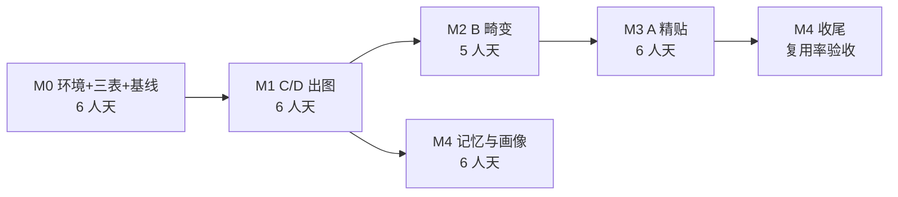

# 牢图棒 · 落地任务文档（TAPS）

> **版本 v2.0 · 环境适配版** ｜ 对应《项目要求文档》v2.0
> 结构：迭代 → 需求 → 任务 → 验收 → 工时
> **TAPS** = Target / Action / Proof / Schedule

---

## 0. 使用说明

### 0.1 四要素约定

每个任务四要素齐全，缺一不排期：

| 要素 | 含义 | 不合格示例 |
|---|---|---|
| **T**arget | 做完什么状态 | 「完善渲染器」 |
| **A**ction | 具体怎么干 | 「想办法弄好」 |
| **P**roof | 怎么验证做完了 | 「看着还行」 |
| **S**chedule | 估时 + 依赖 | 无依赖、无估时 |

### 0.2 工时口径

- 单位：**人天**（1 人天 = 6 小时有效编码）
- 含实现 + 自测 + 改 bug，**不含**等待（模型下载等）
- 单人项目

### 0.3 编号规则

`迭代-需求-任务`，例：`M0-FR0-T01`

### 0.4 优先级

P0 阻塞主路径 ｜ P1 影响体验 ｜ P2 可延后

### 0.5 环境硬约束（每个任务都必须满足）

| 约束 | 值 | 违反后果 |
|---|---|---|
| 进程内存 | ≤ 1.5 GB | 系统换页，体验崩 |
| 推理会话 | ≤ 1 个同时驻留 | 同上 |
| 依赖总体积 | ≤ 500 MB | 磁盘 92 GB 吃紧 |
| 单图边长 | ≤ 2048 px | 内存超限 |
| torch 依赖 | **必须为 0** | 4.2 GB 磁盘 + 1.6 GB 内存 |

---

## 1. 迭代总览

| 迭代 | 名称 | 周期 | 工时 | 关键交付 | 出口门 |
|---|---|---|---|---|---|
| **M0** | 环境 + 数据模型 + 手工基线 | 1.2 周 | **6 人天** | 精简环境 + 三张表 + 四份基线 | 内存峰值 ≤ 1.5 GB 实测通过 |
| **M1** | C/D 出图闭环 | 1.2 周 | **6 人天** | 两图→出图→能存 | 保存率 > 30%；单图 < 1s |
| **M2** | B 畸变 | 1 周 | **5 人天** | 五官形变 + 降质 | 色差保留率差值 > 20pp |
| **M3** | A 精贴 | 1.2 周 | **6 人天** | 前景遮挡 + 整脸贴合 | 遮挡边界肉眼无接缝 |
| **M4** | 记忆与画像 | 1.2 周 | **6 人天** | 记忆 + 画像 + 手感入库 | 配方复用率 > 40% |
| **合计** | — | **5.5~6 周** | **29 人天** | — | — |

> v1.0 为 48 人天 / 8~9 周。**压缩 19 人天（40%）**，全部来自移出生成档与 torch 栈。

---

## M0 · 环境 + 数据模型 + 手工基线

**迭代目标**：把机器准备好，把「做成什么」变成「字段长什么样」，并用真实参数校准所有阈值。

**为什么第一步不做功能**：三张表定错后面全部返工；环境不设预算，M3 阶段必然触发换页。两件事都必须在写渲染代码之前定死。

### M0-FR0 环境基线（P0，新增）

| 任务ID | Target | Action | Proof | S/依赖 |
|---|---|---|---|---|
| M0-FR0-T01 | venv 隔离完成 | 用 Python 3.12 建 `.venv`，**不装 torch**；只装 onnxruntime + opencv + pillow + numpy + scipy + fastapi + uvicorn + pydantic | `pip list` 无 torch；`site-packages` 总计 ≤ 500 MB | 0.5 |
| M0-FR0-T02 | 长路径启用 | 启用 Windows LongPathsEnabled 注册表项 | 能创建 300 字符路径不报错 | 0.2 |
| M0-FR0-T03 | git 就位 | 安装 git，`git init`，首次提交含两份文档 + 4 张参考图 | `git log` 有 1 次提交；`git status` 干净 | 0.3 |
| M0-FR0-T04 | **内存基线实测** | 写一个脚本：加载 ONNX 抠图会话 → 跑一次推理 → 释放，全程采样 RSS | **峰值 ≤ 1.5 GB**；释放后回落到 ≤ 150 MB | 0.5 / T01 |
| M0-FR0-T05 | 目录结构定稿 | 定 `core/ assets/ recipes/ memories/ outputs/ tmp/` 及命名规则 | 目录创建完成；`README` 写明各目录职责 | 0.3 |
| M0-FR0-T06 | 图像 IO 统一层 | 封装读/写/转 alpha/缩放，统一走这一层 | 中文路径读写通过；越界尺寸自动降到 2048 | 0.5 / T01 |

> **M0-FR0-T04 是硬门**：如果峰值超 1.5 GB，就要缩小模型或改 CPU 分块，**不能进入 M1**。

### M0-FR8 三张表 schema（P0）

| 任务ID | Target | Action | Proof | S/依赖 |
|---|---|---|---|---|
| M0-FR8-T01 | 素材卡定稿 | 按 FR-1 实现 `assets` JSON Schema | 5 个真实素材填表全部通过校验；缺字段时错误可读 | 0.8 |
| M0-FR8-T02 | 配方定稿 | 按 FR-3 实现 `recipes` Schema，含 `schema_version`、min/max clamp、归一化坐标 | 四类子类型各写 1 份配方通过校验；非法值被 clamp 而非报错 | 1.0 |
| M0-FR8-T03 | 记忆定稿 | 按 FR-6.1 实现 `memories` 单文件 YAML Schema | 手改一个值后程序正确读取；格式错误有明确报错 | 0.4 / T02 |
| M0-FR8-T04 | 20 用例反查 | 拿 20 张真实牢图逐张用 schema 描述，记录表达不了的情况 | ≥ 18 张完整描述；剩余 2 张缺口记为「已知不支持」 | 0.7 / T01,T02 |

### M0-FR6 手工参数基线（P0）

| 任务ID | Target | Action | Proof | S/依赖 |
|---|---|---|---|---|
| M0-FR6-T01 | C 堆叠基线 | 手工复刻 `image copy 2.png`：记放置坐标/缩放/z 序 | 复刻图 + 参数表；与原图并排差异可描述 | 0.4 |
| M0-FR6-T02 | D 换装基线 | 手工复刻 `image copy 3.png`：记纹理四角点/抠边/背景处理 | 同上 | 0.4 |
| M0-FR6-T03 | B 畸变基线 | 手工复刻 `image copy.png`：记网格控制点/缩放倍数/拉伸比/降质全套 | 同上 + 降质四参数具体值 | 0.6 / T01 |
| M0-FR6-T04 | A 精贴基线 | 手工复刻 `image.png`：记前景层抠法/边缘强度 | 同上 | 0.6 / T02 |

**M0 出口门**：
1. 内存峰值实测 ≤ 1.5 GB ✅
2. 依赖总量 ≤ 500 MB ✅
3. 三张表 Schema 可执行校验 ✅
4. 四份参数基线落盘 ✅
5. 20 用例覆盖率 ≥ 90% ✅

**M0 缓冲**：+0.5 人天（schema 改版风险）

---

## M1 · C/D 出图闭环（最小可用）

**迭代目标**：拖两张图进去，出一张能存下来的牢图。**不接生成模型，不需要 GPU。**

**选 C/D 先做**：技术最简单（纯贴图 + 语义组合），最快验证「会不会存图」。

### M1-FR1 素材入库（P0）

| 任务ID | Target | Action | Proof | S/依赖 |
|---|---|---|---|---|
| M1-FR1-T01 | 抠图可用 | 接入 **ONNX 版 RMBG**，输出带 alpha PNG；**入库时跑一次并缓存** | 10 张素材中 8 张边缘可用；二次读同一素材不触发推理 | 1.2 / M0 |
| M1-FR1-T02 | 符号卡自动打标 | 自动填 `domain` / `circle` / `parts`，允许手改覆盖 | 10 张中 ≥ 7 张标签正确；手改后能覆盖自动值 | 0.8 / T01 |
| M1-FR1-T03 | 拖入即入库 | 支持拖拽/批量导入；内容哈希去重 | 拖 20 张，16 张一次成功；重复导入不新增记录 | 0.8 / T02 |

### M1-FR2 可下手性分析（P0）

| 任务ID | Target | Action | Proof | S/依赖 |
|---|---|---|---|---|
| M1-FR2-T01 | 放置点检测 | 人脸 bbox + 手部 bbox + 头顶空白区 | 10 张基底中 ≥ 8 张检测点位置合理 | 0.8 / M0 |
| M1-FR2-T02 | 遮挡可用性打分 | 启发式判断「是否有头发/手可压住贴入内容」+ 允许手改 | 10 张打分与人工排序相关性 > 0.6 | 0.4 / T01 |
| M1-FR2-T03 | 结果缓存 | 入库时算一次落盘，同图不重算 | 二次调用 < 10ms | 0.4 / T02 |

### M1-FR4 渲染管线（P0）

| 任务ID | Target | Action | Proof | S/依赖 |
|---|---|---|---|---|
| M1-FR4-T01 | `sticker` 可用 | 物件放置：归一化位置/缩放/旋转/z 序 | 用 M0 的 C 类基线参数复现，视觉接近手工版 | 1.0 / M1-FR2-T01 |
| M1-FR4-T02 | `texture_wrap` 可用 | `cv2.warpPerspective` 四角透视贴纹理 | 用 M0 的 D 类基线复现球衣裹身 | 1.0 / T01 |
| M1-FR4-T03 | `degrade` 可用 | 四参数：downscale / jpeg_quality / noise / oversharpen | 关/轻/重三档肉眼可分辨；参数可读写 | 0.6 |
| M1-FR4-T04 | `label` 可用 | FreeType 小字标签：文本/字体/位置/透明度 | 中文正常渲染不豆腐块 | 0.4 |
| M1-FR4-T05 | 管线串联 + 单步落盘 | 固定顺序串起 op，每步产物落盘 | 每步可在前端单独查看；任一步禁用后管线仍能跑完 | 0.6 / T01,T03,T04 |

### M1-FR7 交互与埋点（P0）

| 任务ID | Target | Action | Proof | S/依赖 |
|---|---|---|---|---|
| M1-FR7-T01 | 出图主界面 | 拖入两图 → 选槽位 → 出图 → 保存/重生成 | 全流程 ≤ 5 次点击；单图 < 1s | 1.0 / M1-FR4-T05 |
| M1-FR7-T02 | 行为埋点 | 记录「保存」「重生成」「改参数」为结构化事件 | 三个动作落库，能反查配方 id | 0.4 / T01 |
| M1-FR7-T03 | 中间产物缩略图 | 前端展示每步缩略图，可点击放大 | 每步有缩略图；点击可放大 | 0.4 |

**M1 出口门**：
1. 自测 20 张（10 组素材对），**保存率 > 30%**
2. 单图 < 1s（2048px 内）
3. 同配方重跑逐像素一致
4. 进程内存峰值 ≤ 1.5 GB

**M1 未达门时**：不加新功能，先搞清楚「为什么不存」——逐条记录重生成原因。

---

## M2 · B 畸变（牢图味最浓）

**迭代目标**：把五官扯歪塞进孔位。仍需纯确定性。

### M2-FR4 形变（P0）

| 任务ID | Target | Action | Proof | S/依赖 |
|---|---|---|---|---|
| M2-FR4-T06 | 特征切分 | 从源图切出单块五官（眼/嘴/鼻）+ 带一圈皮肤 | 10 张人脸切出眼/嘴边界可用；带皮圈可调宽 | 1.0 / M0 |
| M2-FR4-T07 | 孔位定位 | 检测目标角色眼窝/口部开孔位置（关键点 + 手改兜底） | 10 张二次元脸中 ≥ 7 张自动成功；其余手改可用 | 1.0 / T06 |
| M2-FR4-T08 | `feature_warp` 可用 | TPS 网格形变 + `cv2.remap` 塞进孔位 | 用 M0 的 B 类基线复现牙膏 logo 五官效果 | 1.4 / T07 |
| M2-FR4-T09 | 刻意失衡参数 | 缩放放大 / 横向拉伸 / 斜挑，三者独立可调 | 三参数各拉满时效果明显不同；参数落入配方 | 0.6 / T08 |
| M2-FR4-T10 | 硬边合成 | 合成不做色彩迁移、不做羽化（0~1px） | 输出边缘为硬边；色差保留率 > 70% | 0.4 / T09 |
| M2-FR4-T11 | 降质预设分档 | 按子类型预置组合（B 中重度 / A 轻 / C,D 关） | 切换子类型时降质参数自动跟随 | 0.4 / M1-FR4-T03 |

### M2-FR5 量化验收（P0）

| 任务ID | Target | Action | Proof | S/依赖 |
|---|---|---|---|---|
| M2-FR5-T01 | 色差保留率可测 | 实现指标：迁移后色差 / 迁移前色差 | 硬贴/半融合/全融合三组输出，指标依次显著下降 | 0.4 |
| M2-FR5-T02 | 边缘梯度可测 | 融合区梯度均值统计 | 硬边 vs 羽化边缘，数值可判 | 0.4 / T01 |
| M2-FR5-T03 | 主可辨性可测 | 拉普拉斯方差（替代人脸 embedding） | 脸糊掉时能判为失败 | 0.4 |

**M2 出口门**：三档违和度的**色差保留率差值 > 20pp**，边缘梯度落在各自带内（**量化分开，不靠肉眼**）。

**M2 风险**：孔位定位对二次元脸准确率不足 → 已保留手改兜底。

---

## M3 · A 精贴（效果最「高级」）

**迭代目标**：写实脸塞进二次元头，靠**前景遮挡**让接缝消失。

**关键技术判断**：成败不在混合算法，在「有没有头发/手压在人脸上」。

**v2 变更**：分层改为**入库时预计算 + 手改**，不实时分割（E-1 单模型驻留）。

### M3-FR4 分层与贴合（P0）

| 任务ID | Target | Action | Proof | S/依赖 |
|---|---|---|---|---|
| M3-FR4-T12 | 前景层粗分 | 入库时用分割模型粗分前景遮挡层/被替换区，结果存盘 | 10 张基底中 7 张粗分可用；结果可手改（刷子/橡皮） | 1.5 / M2 |
| M3-FR4-T13 | 掩码手改工具 | 前端提供前景层的手动涂抹/擦除 | 手改后保存，下次读取生效 | 1.0 / T12 |
| M3-FR4-T14 | z 序合成 | 按 前景 → 贴入内容 → 背景 顺序合成 | 头发正确压在人脸上；交换 z 序后效果明显变差 | 0.6 / T12 |
| M3-FR4-T15 | `face_fit` 可用 | 整脸贴合：按眼睛位置对齐缩放旋转 | 用 M0 的 A 类基线复现写实中年脸效果 | 1.2 / T14 |
| M3-FR4-T16 | 边缘处理 | 遮挡层内边缘不处理、遮挡外轻度羽化 | 遮挡边界处接缝肉眼不可见 | 0.8 / T15 |

### M3 质检与降级（P0）

| 任务ID | Target | Action | Proof | S/依赖 |
|---|---|---|---|---|
| M3-FR5-T04 | 遮挡覆盖率校验 | 统计人脸边界被前景层覆盖比例 | 覆盖率 < 30% 时判「会露接缝」并提示 | 0.4 / T12 |
| M3-FR4-T17 | **自动降级为 B 配方** | 分层不可用时自动改用 B 类形变配方 | 分层失败时输出仍可用，且提示已降级 | 0.5 / T12 |

### M3-FR7 交互补强（P1）

| 任务ID | Target | Action | Proof | S/依赖 |
|---|---|---|---|---|
| M3-FR7-T04 | 步骤时间线 | 每 op 一张卡，可禁用/改参/重跑 | 改第 N 步不重跑前面，反馈 < 300ms | 1.0 / T12 |
| M3-FR7-T05 | 配方面板 | 右侧展示结构化配方，手改即时重渲染 | 改任一数值 300ms 内画面更新 | 0.6 / T04 |

**M3 出口门**：遮挡边界处接缝**肉眼不可见**；A 与 B 配方输出可明显区分；分层失败能自动降级且输出可用。

---

## M4 · 记忆与口味画像（核心卖点）

**迭代目标**：让系统真的记住你，并且你能看见它记了什么。

### M4-FR6 记忆写入（P0）

| 任务ID | Target | Action | Proof | S/依赖 |
|---|---|---|---|---|
| M4-FR6-T01 | 事件采集完整 | 采集 保存/重生成/改参数/换素材/删记忆 五类事件 | 五类全落库且可反查配方 id | 0.6 / M1 |
| M4-FR6-T02 | 双阈值写入 | ≥2 次频次 + >0.7 置信度才写定义层 | 单次不写入；重复两次后写入 | 1.0 / T01 |
| M4-FR6-T03 | 负证据处理 | 重生成/改参数记为负证据 | 连续重生成 3 次后该组合置信度显著下降 | 0.6 / T02 |
| M4-FR6-T04 | 冲突消解 | 新证据加条件不覆盖 | 构造冲突场景，两条并存且带条件 | 0.8 / T02 |
| M4-FR6-T05 | 置信度与衰减 | 权重 = f(频次) × g(时间)；180 天衰减至 0.3 | 构造老数据验证按预期下降 | 0.6 / T02 |
| M4-FR6-T06 | 淘汰与归档 | 置信度 < 0.3 归档（不参与生成但保留） | 归档项不出现在生成依据，数据仍在文件 | 0.4 / T05 |

### M4-FR6 记忆使用（P0）

| 任务ID | Target | Action | Proof | S/依赖 |
|---|---|---|---|---|
| M4-FR6-T07 | 组合检索 | 按「素材 × 基底」检索历史成功组合 | 给定脸源能返回历史成功基底列表 | 1.0 / T02 |
| M4-FR6-T08 | 默认参数跟随 | 子类型偏好决定默认配方 | 偏爱 B 时新任务默认落 B 配方 | 0.6 / T07 |
| M4-FR6-T09 | 为什么这么出 | 结果列出用到的记忆条目 | 每次输出可展开看依据，条目可跳转 | 0.6 / T07 |
| M4-FR6-T10 | 记忆开关 | 「本次不用记忆」开关，位置显眼 | 开启后输出不带偏好，状态持久到本次结束 | 0.3 / T09 |

### M4-FR6 口味画像（P1）

| 任务ID | Target | Action | Proof | S/依赖 |
|---|---|---|---|---|
| M4-FR6-T11 | 画像卡片 | PIL 本地渲染卡片：偏好/反差/字数/素材数/调教次数 | 可导出 PNG，**零网络请求** | 1.0 / T07 |
| M4-FR6-T12 | 口味包导出导入 | 记忆 + 素材清单打包，可导入 | 导出再导入，行为与导出前一致 | 0.6 / T11 |

**M4 出口门**：**配方复用率 > 40%**；前 5 次使用能感知「它记住了」。

**M4 未达门时**：大概率是「写入太宽」导致库被噪声淹没 → 收紧判据，而不是加功能。

---

## 2. 依赖图

**关键路径**：M0 → M1 → M2 → M3 → M4 收尾（约 5.5~6 周）

**可并行点**：M4 的记忆写入（T01~T06）可与 M2/M3 并行，因为只依赖 M1 的事件流；但**复用率验收**必须等 M3 完成。

---

## 3. 里程碑验收清单

| 迭代 | 验收项 | 判据 | 通过 |
|---|---|---|---|
| M0 | 依赖体积 | ≤ 500 MB，无 torch | ☐ |
| M0 | **内存峰值** | **≤ 1.5 GB** | ☐ |
| M0 | 三表可用 | 20 用例覆盖 ≥ 18 | ☐ |
| M0 | 手工基线 | 四类各 1 张 + 参数表 | ☐ |
| M1 | 保存率 | 20 张自测 > 30% | ☐ |
| M1 | 单图耗时 | < 1s（2048px） | ☐ |
| M2 | 档位分离 | 色差保留率差值 > 20pp | ☐ |
| M2 | 硬边成立 | 色差保留率 > 70% | ☐ |
| M3 | 接缝不可见 | 遮挡边界肉眼无痕 | ☐ |
| M3 | 降级可用 | 分层失败时 B 配方输出可用 | ☐ |
| M4 | 复用率 | > 40% | ☐ |
| M4 | 记忆可感 | 前 5 次内可感知 | ☐ |

---

## 4. 风险与缓冲

| 风险 | 影响迭代 | 概率 | 缓冲策略 | 预留 |
|---|---|---|---|---|
| **内存峰值超 1.5 GB** | M0 阻塞全部 | 中 | 缩小模型输入尺寸 / CPU 分块 / 换更小抠图模型 | +1.0 天 |
| schema 缺字段需改版 | M0→全部 | 中 | M0 留缓冲；带 `schema_version` 支持迁移 | +0.5 天 |
| 孔位定位准确率不足 | M2 | 中 | 已含手改兜底 | +0.5 天 |
| `layer_split` 效果差 | M3 | **高** | 半自动 + 自动降级 B 配方 | +1.0 天 |
| 记忆库腐化 | M4 | 高 | 淘汰规则提前到 T02 就实现 | +0.5 天 |
| ONNX 抠图 CPU 太慢 | M1 | 中 | 入库时用 GPU EP；只跑一次 | +0.5 天 |

**总缓冲：+4 人天** → 实际排期建议按 **33 人天 / 6.5 周**。

---

## 5. 砍需求预案

若时间不够，按此顺序砍：

| 顺序 | 砍什么 | 影响 | 省 |
|---|---|---|---|
| 1 | M3 的掩码手改工具（T13） | A 类只能用自动粗分，成功率下降 | 1.0 天 |
| 2 | M4 口味画像（T11、T12） | 少传播点，核心记忆仍在 | 1.6 天 |
| 3 | M3 步骤时间线（T04、T05） | 退化为「一键出图」，调试变难 | 1.6 天 |
| 4 | M2 量化验收（T01~T03） | 失去客观判据，退化为肉眼 | 1.2 天 |
| 5 | M1 符号卡自动打标（T02 自动部分） | 全手工打标，入库变慢 | 0.8 天 |

> **绝对不能砍**：M0 全部、M1 保存率验证、M3 自动降级、M4 记忆写入与检索。
> 砍掉这些，项目就失去了唯一的核心卖点或稳定性保障。

---

## 6. 第一个可执行的 5 天计划

| 天 | 上午 | 下午 | 产出 |
|---|---|---|---|
| **D1** | M0-FR0-T01 venv（**不装 torch**）+ T02 长路径 + T03 git | M0-FR0-T04 **内存基线实测** | 环境就绪、内存预算验证 |
| **D2** | M0-FR8-T01 素材卡 schema | M0-FR8-T02 配方 schema | 两张表定稿 |
| **D3** | M0-FR8-T03 记忆表 + T04 反向验证 | M0-FR6-T01/T02 C/D 手工复刻 | 三张表 + 2 份基线 |
| **D4** | M1-FR1-T01 抠图接入 | M1-FR2-T01 放置点检测 | 能抠能放 |
| **D5** | M1-FR4-T01 `sticker` + T03 `degrade` | M1-FR7-T01 主界面，自测 20 张 | **第一版能存图** |

**D1 的硬门**：内存峰值若超过 1.5 GB，**当天就要解决**，不要带着问题往下走。解决手段优先级：缩小模型输入 → 换更小模型 → CPU 分块推理。

**D5 结束时的唯一判断问题**：
> **你自己愿意把这张图存下来发出去吗？**

- 愿意 → 方向正确，继续 M2
- 不愿意 → 停下来分析原因，**不要往 M2 推**。大概率是素材库太薄或槽位太粗，不是渲染问题。

---

## 7. v1 → v2 任务变更对照

| 变更 | 说明 |
|---|---|
| **新增 M0-FR0 环境基线**（6 项） | v1 完全没有这一块，是最大遗漏 |
| **移除 M5 整个迭代**（12 人天） | 生成档本地不可行 |
| 移除 M3 光照方向对齐 | 需要额外模型，省 1.5 天且环境不允许 |
| 移除 M3-FR9 素材匹配度检查（4 项判据） | 依赖多模型，v2 无生成档兜底后价值下降 |
| 移除 M1 批量模式 | 内存与排期不划算 |
| 移除 SSE 推流 | 无长任务 |
| 移除人脸 embedding 质检 | 省一个模型，改用拉普拉斯方差 |
| A 类分层从「实时自动」改「入库预计算 + 手改」 | 单模型驻留约束 |
| 新增 M3-FR4-T13 掩码手改工具 | 补偿自动分割质量不足 |
| 新增 M3-FR4-T17 自动降级为 B 配方 | 保证 A 失败时仍有输出 |
| 工时 48 → **29 人天** | 压缩 40% |
| 周期 8~9 周 → **5.5~6 周** | |
